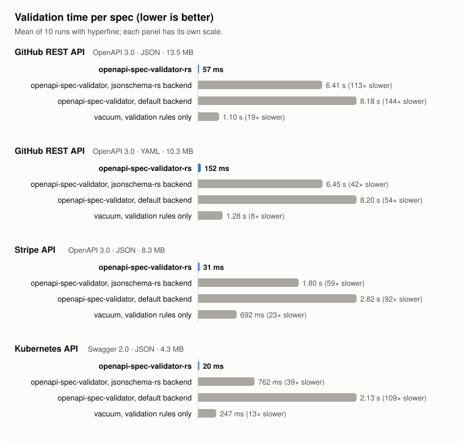

# Benchmarks



Measured on an Apple M4 (10 cores, 16 GB) with macOS 26.6, CPython 3.13.14, hyperfine 2.0.0.

## Command line, one spec at a time

Mean wall time of 10 runs (after one warm-up), including process start-up, reading and
parsing:

| Spec | openapi-spec-validator-rs | openapi-spec-validator, jsonschema-rs backend | openapi-spec-validator, default backend | vacuum (validation rules) |
|---|---:|---:|---:|---:|
| GitHub (OpenAPI 3.0, JSON, 13.5 MB) | **57 ms ± 1** | 6.41 s ± 0.02 (113× slower) | 8.18 s ± 0.03 (144× slower) | 1.10 s ± 0.02 (19× slower) |
| GitHub (OpenAPI 3.0, YAML, 10.3 MB) | **152 ms ± 3** | 6.45 s ± 0.02 (42× slower) | 8.20 s ± 0.02 (54× slower) | 1.28 s ± 0.01 (8× slower) |
| Stripe (OpenAPI 3.0, JSON, 8.3 MB) | **31 ms ± 0** | 1.80 s ± 0.01 (59× slower) | 2.82 s ± 0.01 (92× slower) | 692 ms ± 9 (23× slower) |
| Kubernetes (Swagger 2.0, JSON, 4.3 MB) | **20 ms ± 0** | 762 ms ± 4 (39× slower) | 2.13 s ± 0.01 (109× slower) | 247 ms ± 4 (13× slower) |

Peak memory (resident set):

| Spec | openapi-spec-validator-rs | openapi-spec-validator, jsonschema-rs backend | openapi-spec-validator, default backend | vacuum (validation rules) |
|---|---:|---:|---:|---:|
| GitHub (OpenAPI 3.0, JSON, 13.5 MB) | 81 MiB | 291 MiB | 289 MiB | 1399 MiB |
| GitHub (OpenAPI 3.0, YAML, 10.3 MB) | 132 MiB | 292 MiB | 289 MiB | 1434 MiB |
| Stripe (OpenAPI 3.0, JSON, 8.3 MB) | 49 MiB | 184 MiB | 181 MiB | 857 MiB |
| Kubernetes (Swagger 2.0, JSON, 4.3 MB) | 31 MiB | 122 MiB | 120 MiB | 325 MiB |

## Python API

`validate(spec_dict)` on a document already loaded with `json.load`, timed in a fresh
interpreter per run (median of 5), so it excludes start-up and parsing. This is the cost of
validating FastAPI's `app.openapi()` in a test:

| Spec | openapi-spec-validator-rs | openapi-spec-validator, jsonschema-rs backend | openapi-spec-validator, default backend |
|---|---:|---:|---:|
| GitHub (13.5 MB) | **33 ms** | 4.67 s (143× slower) | 6.38 s (196× slower) |
| Stripe (8.3 MB) | **16 ms** | 0.89 s (55× slower) | 1.91 s (119× slower) |
| Kubernetes (4.3 MB) | **11 ms** | 0.33 s (29× slower) | 1.70 s (149× slower) |

## Whole corpus

All 3,646 APIs.guru specs that both of openapi-spec-validator's backends accept (535 MB
of YAML, Swagger 2.0 to OpenAPI 3.1), passed to one process per tool. Both CLIs stop
at the first invalid file, so the rejected specs are left out. openapi-spec-validator-rs:
mean of 3 runs after a warm-up; openapi-spec-validator: one run each:

| Tool | Time | |
|---|---:|---|
| openapi-spec-validator-rs (10 threads) | **1.6 s** | |
| openapi-spec-validator-rs (1 thread) | 8.0 s | |
| openapi-spec-validator, jsonschema-rs backend | 202 s | 126× slower (25× single-threaded) |
| openapi-spec-validator, default backend | 332 s | 207× slower (42× single-threaded) |

openapi-spec-validator validates files one after another; openapi-spec-validator-rs
validates them in parallel and reports them in order.

## Agreement

Speed only matters if the answers are the same. On the 4,138 specs of the APIs.guru
directory, openapi-spec-validator-rs gives the same verdict (valid, or the same error
class) and the same first line of output as openapi-spec-validator 0.9.0 with its default
backend for **4,138 of 4,138** specs, and the same verdict as its jsonschema-rs backend for
4,128 (the 10 differences are format checks only that backend makes; on those specs
upstream's two backends disagree with each other). `scripts/agreement.py` reproduces this.

## What is measured

Each command validates one file from the command line, so times include process
start-up and parsing, exactly as a user or CI job experiences them.

| Tool | Command |
|---|---|
| openapi-spec-validator-rs 0.1.0 | `openapi-spec-validator-rs FILE` |
| openapi-spec-validator 0.9.0, default backend | `OPENAPI_SPEC_VALIDATOR_SCHEMA_VALIDATOR_BACKEND=jsonschema openapi-spec-validator FILE` |
| openapi-spec-validator 0.9.0, jsonschema-rs backend | `OPENAPI_SPEC_VALIDATOR_SCHEMA_VALIDATOR_BACKEND=jsonschema-rs openapi-spec-validator FILE` (jsonschema-rs 0.60.1) |
| vacuum 0.35.1 | `vacuum lint -q -x -r bench/vacuum-validate.yaml FILE` |

openapi-spec-validator picks its jsonschema-rs backend automatically when that package is
installed; both backends are pinned explicitly here. vacuum is a linter with its own
rules, not a drop-in replacement: it is run with a ruleset limited to the checks
openapi-spec-validator also performs (meta-schema, unique operation IDs, path
parameters), and it reaches different verdicts on some documents (for example, it
rejects Stripe's spec for circular references that openapi-spec-validator accepts).

## Specs

| Spec | Version | Format | Size |
|---|---|---|---:|
| [GitHub REST API](https://github.com/github/rest-api-description) | OpenAPI 3.0.3 | JSON | 13.5 MB |
| GitHub REST API | OpenAPI 3.0.3 | YAML | 10.3 MB |
| [Stripe API](https://github.com/stripe/openapi) | OpenAPI 3.0.0 | JSON | 8.3 MB |
| [Kubernetes API](https://github.com/kubernetes/kubernetes/tree/master/api/openapi-spec) | Swagger 2.0 | JSON | 4.3 MB |
| [APIs.guru directory](https://github.com/APIs-guru/openapi-directory) | 2.0 to 3.1 | YAML | 4,138 specs |

## Reproduce

```bash
python -m venv .venv-upstream
.venv-upstream/bin/pip install openapi-spec-validator==0.9.0 jsonschema-rs==0.60.1
UPSTREAM=$PWD/.venv-upstream/bin bench/run.sh            # per-spec timings and chart
UPSTREAM=$PWD/.venv-upstream/bin CORPUS=1 bench/run.sh   # also the APIs.guru corpus (slow)
```

`bench/run.sh` downloads the specs into `bench/data/`, builds the release binary, runs
[hyperfine](https://github.com/sharkdp/hyperfine) and writes `bench/results/` and
`bench/benchmarks.svg`. `bench/python_api.py` times the Python API, and
`scripts/agreement.py` measures verdict agreement on the corpus.
